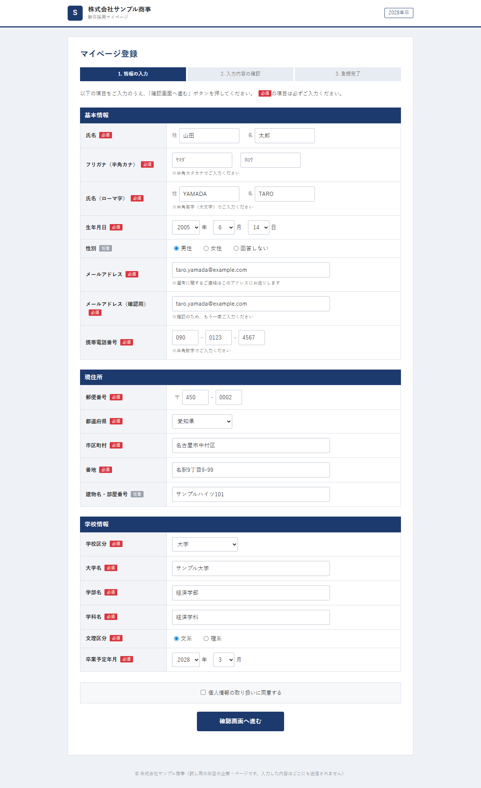
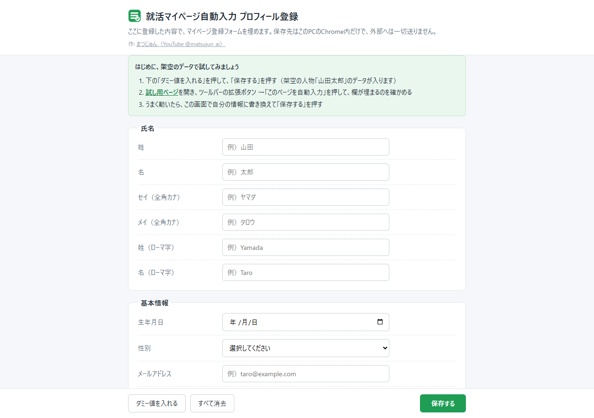
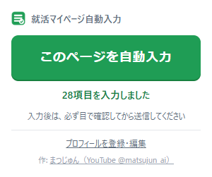

# 就活マイページ自動入力（Chrome拡張）

就活サイトの「マイページ登録」で、名前・住所・大学名などを毎回打つのは大変です。
この拡張に自分の情報を1回登録しておけば、登録画面でボタンを押すだけで欄が埋まります。

- 無料で使えます
- 入れた情報は、あなたのパソコンのChromeの中だけに保存されます。外部には送りません
- パソコン版のChromeで使えます（スマホでは使えません）

## 入れ方（はじめの1回だけ）

1. [ダウンロードページ](https://github.com/Central-AX/shukatsu-autofill/releases/latest)を開き、`shukatsu-autofill-v〇〇.zip` をクリックしてダウンロードする（下にある「Source code」ではなく、こちらを選びます）
2. ダウンロードしたZIPを解凍する（Windowsは右クリック →「すべて展開」、Macはダブルクリック）。`shukatsu-autofill` というフォルダができます
3. Chromeのアドレスバーに `chrome://extensions` と入力して開く
4. 右上の「デベロッパー モード」をオンにする
5. 左上の「パッケージ化されていない拡張機能を読み込む」を押し、手順2でできた `shukatsu-autofill` フォルダを選ぶ
6. Chrome右上のパズルのマークを押し、「就活マイページ自動入力」の横のピンを押す。ボタンがいつも表示されるようになります

> **解凍したフォルダは、消したり動かしたりしないでください。** Chromeはこのフォルダを読み込んで動いています。消すと拡張が動かなくなります。デスクトップなど、消さない場所に置いてから手順5を行うのがおすすめです。

入れ終わると、プロフィール登録の画面が自動で開きます。

## 使い方

### 1. まず、架空のデータで試す

1. 登録画面の下にある「ダミー値を入れる」を押し、「保存する」を押す（架空の人物「山田太郎」のデータが入ります）
2. [試し用ページ](https://central-ax.github.io/shukatsu-autofill/demo/mypage.html)を開く（架空の会社のページです。何も送信されません）
3. Chrome右上の拡張のボタン →「このページを自動入力」を押す。欄が一気に埋まれば成功です

### 2. 自分の情報を登録する

登録画面で、ダミーの値を自分の情報に書き換えて「保存する」を押します。
登録画面は、拡張のボタン →「プロフィールを登録・編集」からいつでも開けます。

### 3. 就活サイトで使う

マイページの登録画面を開いて、拡張のボタン →「このページを自動入力」を押します。

- **入力が終わったら、送信する前に必ず自分の目で確認してください。** サイトによっては、うまく入らない欄や、違う欄に入ってしまうことがあります
- すでに何か入っている欄は書き換えません
- 「個人情報の取り扱いに同意する」などのチェックは押しません。自分で読んでからチェックしてください

## 何が埋まる？

| 項目 | 入る内容 |
|---|---|
| 氏名 | 漢字・フリガナ・ローマ字。姓と名が分かれた欄でも、1つの欄でも入ります。フリガナは「半角カナ」「ひらがな」などの指定に合わせます |
| 生年月日・卒業予定年月 | 「年・月・日」を選ぶ形でも、1つの欄に書く形でも入ります |
| 電話番号・郵便番号 | 3つに分かれた欄でも、1つの欄でも入ります。「ハイフンなし」の指定があればハイフンを抜きます |
| メールアドレス | 確認用（もう一度入力する欄）にも同じものを入れます |
| 住所 | 都道府県・市区町村・番地・建物名。「住所」が1つの欄ならつなげて入れます |
| 学校 | 学校の種類・大学名・学部・学科・文系／理系 |
| 性別 | 選ぶ形・丸を付ける形のどちらでも入ります |

**入れない欄**: パスワード、ユーザー名、帰省先・緊急連絡先・保護者の情報、自宅の電話・FAX、大学名のフリガナ、入学年月、出身高校、自己PRなど。これらは自分で入れてください。

## 安全について

- **外部への送信はしません。** 登録した情報は、あなたのパソコンのChromeの中だけに保存されます。ほかのパソコンや、ほかの人とは共有されません
- **ボタンを押したページだけを触ります。** ふだん見ているページを読み取ったり、勝手に動いたりはしません
- **パスワードと同意のチェックは触りません**
- この拡張がChromeに求める権限は次の3つだけです

| 権限 | 何に使うか |
|---|---|
| 保存（storage） | 登録したプロフィールを、このパソコンのChromeに保存する |
| 今開いているタブ（activeTab） | ボタンを押したタブだけを、押したときだけ触る |
| 処理の実行（scripting） | そのタブの入力欄に、プロフィールを入れる |

## よくある質問

**Q. ボタンを押しても埋まらない欄がある**
サイトによって、欄の作りが特殊なことがあります。埋まらなかった欄は空のまま残るので、手で入れてください。

**Q. 「このページでは使えません」と出る**
Chromeの設定画面や、ウェブストアなどのページでは使えません。就活サイトの登録画面で押してください。

**Q. 郵便番号を入れたら住所が変わった**
郵便番号から住所を自動で入れるサイトでは、サイト側が住所の欄を書き換えることがあります。送信前に住所を確認してください。

**Q. 新しいバージョンにしたい**
1. [ダウンロードページ](https://github.com/Central-AX/shukatsu-autofill/releases/latest)から新しいZIPをダウンロードして解凍する
2. いま使っている `shukatsu-autofill` フォルダの中身を、新しいフォルダの中身で置き換える（フォルダの場所は変えない）
3. `chrome://extensions` で「就活マイページ自動入力」の更新ボタン（丸い矢印のマーク）を押す

フォルダの場所が同じなら、登録したプロフィールはそのまま残ります。

**Q. 消したい**
`chrome://extensions` で「就活マイページ自動入力」の「削除」を押します。登録したプロフィールも一緒に消えます。そのあと、解凍したフォルダを消してください。

## 作者

まつじゅん（YouTube [@matsujun_ai](https://www.youtube.com/@matsujun_ai)）／Central AX

## ライセンス

MIT License（[LICENSE](LICENSE)）。自由に使えますが、使ったことで起きた問題について作者は責任を負いません。送信前の確認は、必ずご自身で行ってください。

---

開発者向けの説明（仕組み・テスト・配布用ZIPの作り方）は [docs/DEVELOPERS.md](docs/DEVELOPERS.md) にあります。
